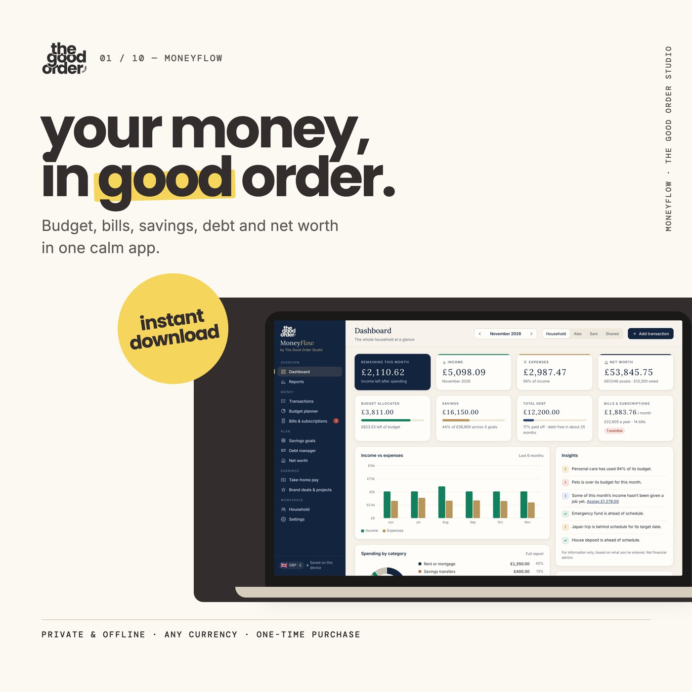
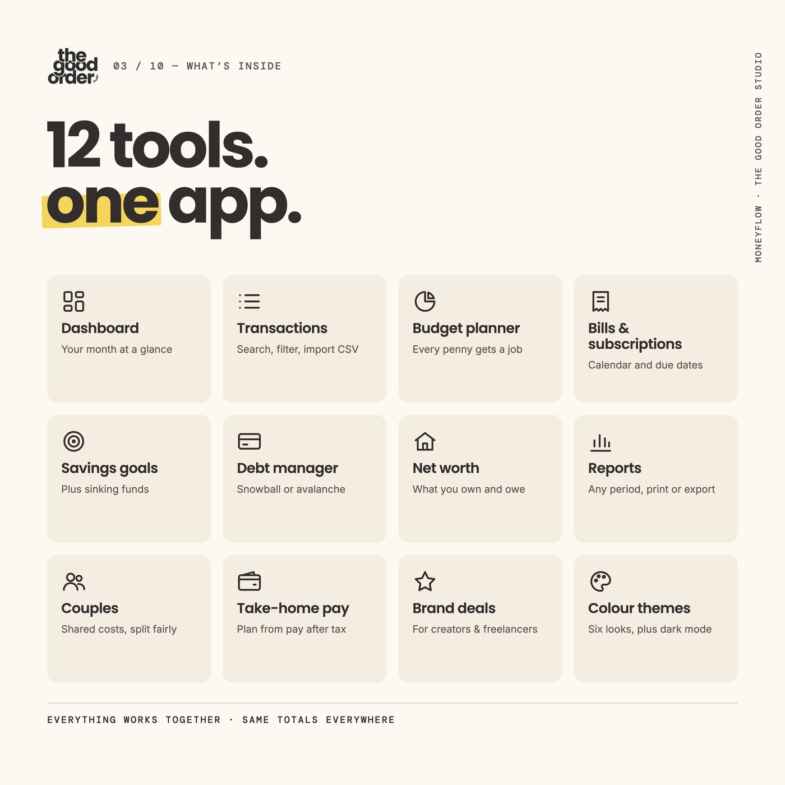
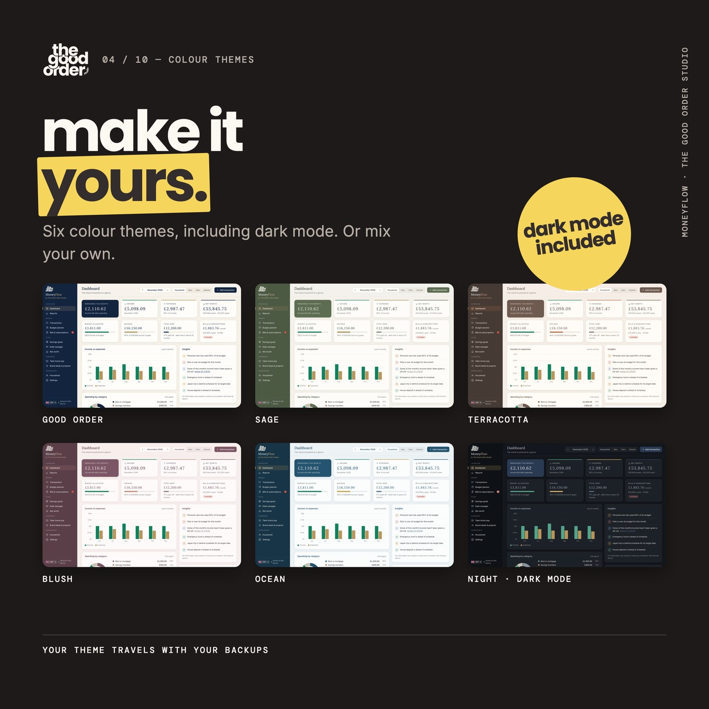

# MoneyFlow — free demo

your money, in good order.

This is the free demo of MoneyFlow by The Good Order Studio, a personal finance app for budgets, bills, savings goals, debt payoff and net worth.

▶ Try it: https://thegoodorderstudio.github.io/moneyflow-demo/

- Explore with fictional sample data, or as an individual or a couple
- Nothing to install, no account, and nothing is sent to a server
- Best on a computer, in Chrome, Edge, Firefox or Safari

The full version, with the Excel and Google Sheets editions and step-by-step guides, is available from The Good Order Studio.

---

© 2026 The Good Order Studio. All rights reserved.

MoneyFlow is original, copyrighted work. This demo is for trying MoneyFlow in your browser only. It is **not open source**: copying, modifying, reselling, rebranding, re-hosting or using it, its code or its images to make other products is not permitted. See [LICENSE](LICENSE).
